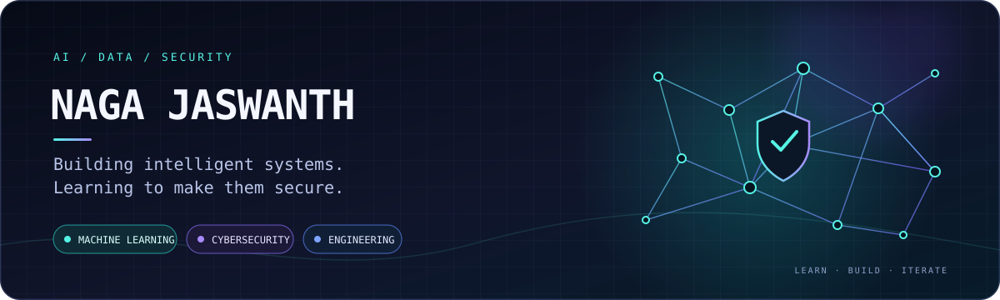

<!-- PROFILE HERO -->
<p align="center">
  
</p>

<p align="center">
  <a href="https://github.com/Jaswanth300"></a>
  
  
</p>

<h3 align="center">Building intelligent systems. Learning to make them secure.</h3>

<p align="center">
  B.Tech AI & Data Science · Saveetha School of Engineering, SIMATS · 2024–2028
</p>

<p align="center">
  <a href="#-selected-work">Explore my work</a> ·
  <a href="#-toolkit">Toolkit</a> ·
  <a href="#-activity">Activity</a> ·
  <a href="https://github.com/Jaswanth300">GitHub profile ↗</a>
</p>

---

## ◈ A little about me

I'm an AI & Data Science student who learns by turning concepts into working projects. I'm especially interested in the space where **machine learning meets cybersecurity** — from detecting suspicious URLs to building systems that are useful, measurable, and reliable.

- 🧠 **Exploring:** machine learning, model evaluation, and data-driven systems
- 🛡️ **Building toward:** cybersecurity, phishing detection, and secure software
- 🧰 **Practising:** Python, APIs, computer vision, Git, and core CS
- 🏆 **Milestone:** 3rd Place — Cyber Catalyst 2026 (Vibeathon)

---

## 🚀 Selected work

<table>
  <tr>
    <td width="50%" valign="top">
      <a href="https://github.com/Jaswanth300/Phishing-URL-Detection"></a>
      <strong>🛡️ Phishing URL Detection</strong>
      <p>Machine learning pipeline for classifying legitimate and phishing URLs, comparing Logistic Regression, SVM, and tuned Random Forest.</p>
      <p><code>Python</code> <code>scikit-learn</code> <code>Flask API</code></p>
      <p><strong>Best reported test accuracy: 90.6% (SVM)</strong></p>
    </td>
    <td width="50%" valign="top">
      <a href="https://github.com/Jaswanth300/Student-Stress-Prediction"></a>
      <strong>🧠 Student Stress Prediction</strong>
      <p>A classification project using a Decision Tree, model evaluation, confusion matrix, and feature-importance visualisation.</p>
      <p><code>Python</code> <code>Machine Learning</code> <code>Evaluation</code></p>
    </td>
  </tr>
  <tr>
    <td width="50%" valign="top">
      <a href="https://github.com/Jaswanth300/Student-Result-Prediction"></a>
      <strong>📈 Student Result Prediction</strong>
      <p>A regression project exploring score prediction and error analysis through MAE, R², and actual-versus-predicted visualisation.</p>
      <p><code>Python</code> <code>Linear Regression</code> <code>Data Visualisation</code></p>
    </td>
    <td width="50%" valign="top">
      <a href="https://github.com/Jaswanth300/OpenCV"></a>
      <strong>👁️ Computer Vision Lab</strong>
      <p>Hands-on practice with image processing and computer-vision fundamentals using OpenCV.</p>
      <p><code>Python</code> <code>OpenCV</code> <code>Image Processing</code></p>
    </td>
  </tr>
</table>

<p align="center">
  <a href="https://github.com/Jaswanth300?tab=repositories"><strong>Browse all repositories →</strong></a>
</p>

---

## 🧩 Toolkit

<p align="center">
  
</p>

<p align="center">
  <sub>Currently sharpening fundamentals while building projects that connect AI, data, and security.</sub>
</p>

---

## 📊 Activity

<p align="center">
  
  
</p>

<p align="center">
  
</p>

---

## 🧭 What I'm working toward

```text
01  Stronger Python + data structures and algorithms
02  Better ML experimentation, validation, and explainability
03  Practical cybersecurity and secure-system engineering
04  Clear documentation, reliable APIs, and deployable projects
```

---

## 🤝 Find me

<p align="center">
  <a href="https://github.com/Jaswanth300"></a>
  <a href="https://github.com/Jaswanth300?tab=repositories"></a>
</p>

<p align="center"><i>Curious by default. Practical by design. Always building.</i></p>
